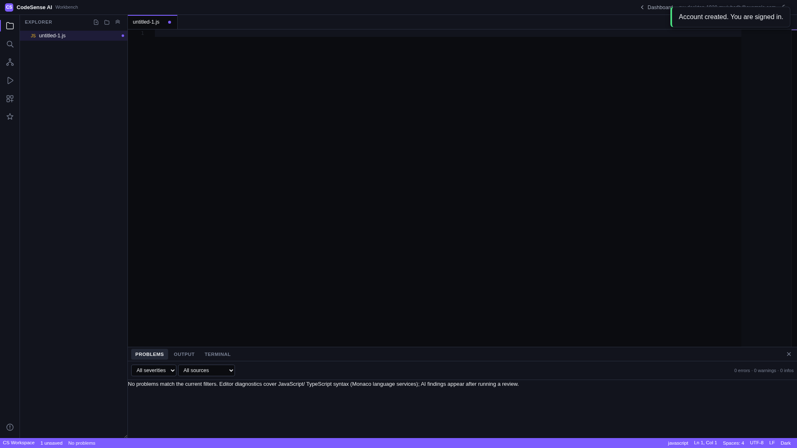
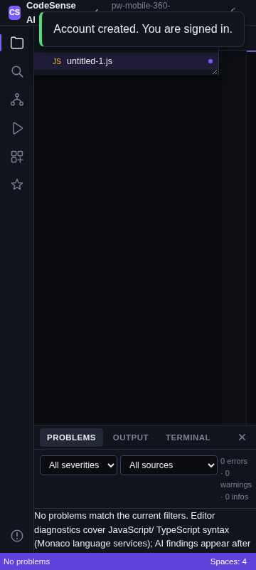
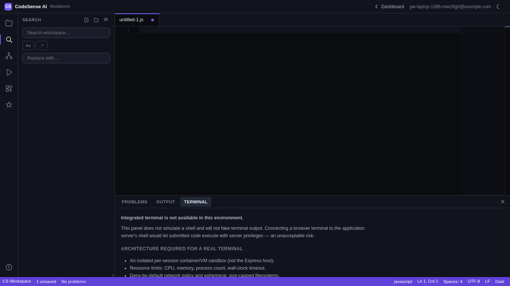
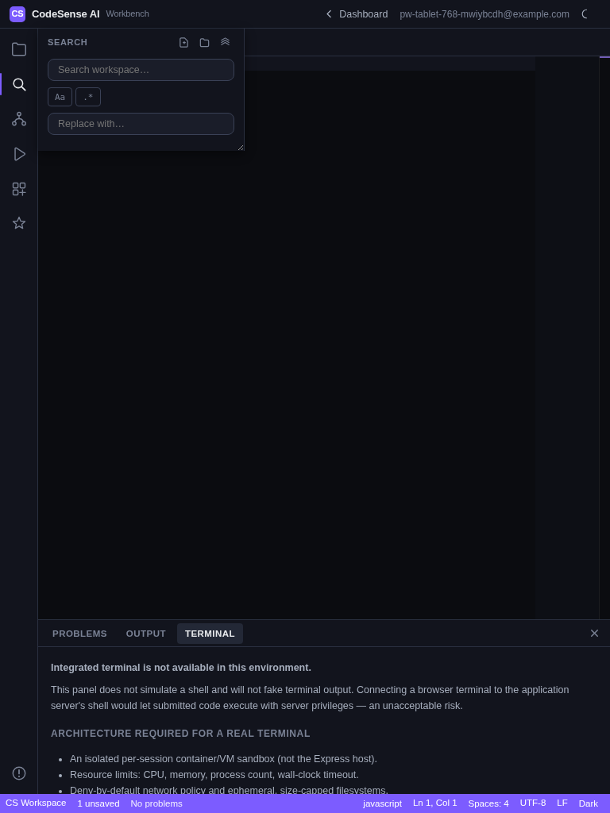

# CodeSense AI

<p align="center">
  
</p>

**A VS Code-inspired AI-powered browser-based developer workbench.** Multi-file Monaco editing, an AI code-review studio, honest local change tracking, a command palette, and a live status bar — built on a secure Express/MongoDB backend with Gemini-powered review (server-side only; the API key never reaches the browser).

[](./LICENSE)
[](https://nodejs.org/)
[](https://expressjs.com/)
[](https://www.mongodb.com/)
[](https://ai.google.dev/)
[](https://microsoft.github.io/monaco-editor/)

Repository: https://github.com/Manash07Bhoi/VS-Code

---

## Project overview

**CodeSense AI** combines three things in one browser application:

1. **A VS Code-like AI IDE** — activity bar, explorer with a real file tree, multi-file tabs with dirty state, command palette (`Ctrl+Shift+P`) and quick open (`Ctrl+P`), status bar reflecting live editor state, Problems/Output/Terminal panels, dark and light themes.
2. **A premium AI Code Review Studio** — review the current file, a selection, or with a security focus; every review is persisted to your account with severity, confidence, evidence and line references; findings navigate to real source lines and refuse to when they have gone stale; "generate fix suggestions" proposes improved code in a side-by-side diff that is only applied when you approve it.
3. **A developer workbench** — workspace-wide search & replace, honest local change tracking with checkpoints (clearly **not** Git), and truthful unavailable states for terminal/run/debug that document exactly what a safe implementation would require instead of faking it.

**Intended users:** learners and developers who want a second set of eyes on their code, with explanations written in beginner-friendly plain language.

**Honesty policy:** if the Gemini API key is not configured, every AI action returns a truthful provider-unavailable state — nothing is simulated. No user-submitted code is ever executed. The browser-local workspace is labeled as browser-local, never as server storage or version control.

---

## Screenshots (actual application)

All screenshots below are captured by the automated browser tests from the real application (committed under `tests/artifacts/screenshots/`):

| Workbench — desktop 1920×1080 | Workbench — mobile 360×800 |
|---|---|
|  |  |

| Workbench + panels — laptop 1366×768 | Workbench + panels — tablet 768×1024 |
|---|---|
|  |  |

Additional evidence: Playwright HTML report (`tests/artifacts/html-report/`) and Lighthouse audits (`tests/artifacts/lighthouse/`).

---

## Key features (implemented & verified)

### The workbench
- **Activity bar & panels** — Explorer (file tree, folders, context menu, create/rename/delete with confirmations), Search (case/regex, match navigation, guarded replace-all), Source Control (local changes + checkpoints, honestly not Git), Run/Debug and Terminal (truthful unavailable states with the architecture they would require), Supported Integrations (live language registry + provider status), AI Review, Problems with a live count badge.
- **Multi-file editor** — Monaco with one model per file, tabs (dirty dots, close/close-others, middle-click), unsaved-change protection, persisted open editors, find/replace, folding, minimap, multi-cursor, JS/TS syntax diagnostics in the Problems panel.
- **Command palette** — 28 working commands (save, save all, new file, open file, find, replace, panel toggles, theme, language, AI actions…) with keybinding hints. No dead commands.
- **Status bar** — live language, cursor position and selection, indentation, encoding, line endings, unsaved count, problems.
- **Diff viewer** — Monaco diff for local changes and AI proposals with explicit Accept/Reject; accepting only marks the file dirty — you still save.
- **Themes** — dark and light, persisted.
- **Responsive** — verified by automated tests at 360×800, 390×844, 768×1024, 1366×768 and 1920×1080.

### AI review
- **Review current file / selection / security focus** — persisted findings (bug/correctness, security, performance, code-quality) with severity, confidence, explanation, impact, recommendation, evidence, line references, caveats.
- **Explain code** and **Generate fix suggestions** — ephemeral assist results (never persisted server-side) with the diff-review workflow.
- **Review history** — owner-scoped persistence, filters, pagination, deletion.

### Platform
- **Authentication** — registration, login, logout, session rotation on login, generic credential errors (no account enumeration), bcrypt (work factor 12).
- **Security controls** — CSRF double-submit, HttpOnly/Secure/SameSite cookies, CORS allow-list, request size limits, rate limiting on API routes, CSP with CDN allow-lists, secret scanning in CI.
- **Health checks** — liveness and readiness endpoints.

### Verified quality (this release)
- Backend test suite: **19 tests across 5 test files, all passing** (deterministic mocked provider tests included).
- Browser QA: **Playwright 7/7** across five viewports (evidence committed) and **puppeteer e2e 28/29 checks passed in the sandbox** (1 honest environment-skip: the Monaco tsWorker CDN fetch is blocked by the sandbox network; CI exercises it).
- Lighthouse (local release build, real backend+frontend, Lighthouse 12.8.2): desktop **P100 / A100 / BP96 / SEO100**; mobile **P90–99 / A100 / BP96 / SEO100**, CLS 0 (six reports committed under `tests/artifacts/lighthouse/`). The BP 0.96 deduction is the documented, accepted `errors-in-console` item (the anonymous session boot-check legitimately returns 401).
- Dependency audit: **0 vulnerabilities** (reproduced with `npm audit` — see `docs/security/VULNERABILITY_REGISTER.md`).
- Brand: the official Concept 01 logo kit is integrated — favicon (`.ico` + PNG sizes), PWA manifest & icons, Open Graph / Twitter social preview, apple-touch-icon, and the logo image in the navbar, sidebar, landing, auth pages, workbench title bar, welcome screen and boot splash.

**Not implemented (by design):** terminal, code execution, debugging, real Git integration — each has a truthful unavailable state and documented architecture; see `docs/implementation/KNOWN_LIMITATIONS.md`. **Credential-dependent:** live Gemini analysis needs a real `GEMINI_API_KEY`.

---

## Technology stack

| Layer | Technology |
|---|---|
| Frontend | Vanilla JavaScript (ES modules), HTML, CSS — no framework; Monaco Editor 0.52 via CDN (CSP allow-listed); official Concept 01 brand assets (favicon, PWA icons, social preview) |
| Backend | Node.js ≥ 20, Express 4, Zod v4 validation |
| Database | MongoDB 8 with Mongoose |
| AI | Google Gemini (`@google/generative-ai`), server-side only |
| Auth | Session cookies + CSRF (connect-mongodb-session store) |
| Browser QA | Playwright + Puppeteer (devDependencies only) |
| CI | GitHub Actions (lint, tests, secret scan, browser QA, e2e) |

---

## Architecture

See `docs/architecture/`:
- `SYSTEM_ARCHITECTURE.md` — topology, trust boundaries, deployment reality
- `IDE_WORKBENCH_ARCHITECTURE.md` — the workbench module map and behaviors
- `AI_REVIEW_ARCHITECTURE.md` — review/assist flows, prompt-injection resistance
- `SECURITY_ARCHITECTURE.md` — auth/session/CSRF/rate-limit/execution policy
- `DATA_FLOW.md` — end-to-end data flows

```
Browser (SPA + workbench + browser-local workspace)
   │  JSON + session cookie + CSRF
   ▼
Express API (/api/v1: auth, languages, reviews, assist, health)
   │
   ├── MongoDB (users, sessions, reviews)
   └── Gemini provider (server-side key)
```

---

## Installation (local development)

Prerequisites: Node.js ≥ 20, MongoDB running on `127.0.0.1:27017`.

```bash
git clone https://github.com/Manash07Bhoi/VS-Code.git
cd VS-Code/backend
npm ci
cp .env.example .env    # fill in the required variables (never commit .env)
npm run dev             # serves frontend + API on http://localhost:3000
```

Configuration (all variables documented in `backend/.env.example`):
- Required: `MONGODB_URI`, `SESSION_SECRET`, `FRONTEND_ORIGIN`
- Optional: `GEMINI_API_KEY` + `GEMINI_MODEL` (without them the app runs and shows honest provider-unavailable states), rate-limit tuning, cookie/CSRF settings

---

## Testing

```bash
cd backend
npm run lint            # ESLint (0 errors)
npm test                # 19 tests across 5 test files (needs MongoDB on 127.0.0.1:27017)

# Browser QA (backend running on :3000)
node tests/e2e.js                                    # puppeteer e2e (29 checks)
node backend/node_modules/@playwright/test/cli.js test --config playwright.config.js
```

Evidence and details: `docs/testing/` (strategy, Playwright report, regression report, Lighthouse report).

---

## Security notes

- The Gemini API key never leaves the backend.
- No user-submitted code is executed anywhere (no terminal/execution/debugging — see KNOWN_LIMITATIONS.md).
- Dependency audit: **0 vulnerabilities** (register: `docs/security/VULNERABILITY_REGISTER.md`).
- Report vulnerabilities via GitHub issues; see `SECURITY.md`.

---

## Deployment status (honest)

Live and verified on **free tiers only** (2026-11-17):

| Component | URL | Host / plan |
| --- | --- | --- |
| Frontend | <https://codesenseai-review.netlify.app> | Netlify (static, free) |
| Backend API | <https://codesense-ai-backend-9skh.onrender.com> | Render **Free** web service, Singapore |
| Database | Atlas cluster `ym9wxlr` / db `codesense_ai` | MongoDB Atlas free tier |

- The frontend reaches the API through a **same-origin proxy**: `/api/*` on the Netlify
  site is rewritten to the Render service (`frontend/_redirects`), so the session cookie
  stays first-party (`SameSite=Lax; Secure; HttpOnly`) and CSRF headers pass through.
- Health: <https://codesense-ai-backend-9skh.onrender.com/api/v1/health/live> →
  `{"status":"ok"}`; readiness at `/api/v1/health/ready` reports
  `{"database":"connected","provider":"…"}`.
- **AI reviews are not enabled on this deployment:** no Gemini API key was configured, so
  `POST /api/v1/reviews` returns an honest `502 "AI provider is not configured on the
  server."` and `POST /api/v1/assist` returns `503 PROVIDER_UNAVAILABLE`. No mock or
  simulated AI output is ever returned. Set the `GEMINI_API_KEY` environment variable in
  Render to activate real reviews — no code change needed.
- Render Free spins the service down after 15 minutes of inactivity; the first request
  afterwards is slow. Sessions are stored in Atlas, so a restart does not log users out.
- Full deployment record, environment variables, verification evidence and free-tier
  limits: [`docs/deployment/RENDER_FREE_DEPLOYMENT.md`](docs/deployment/RENDER_FREE_DEPLOYMENT.md).
- The CD workflow still deploys the frontend only; the backend is deployed by Render from
  `main` (`rootDir: backend`, auto-deploy on push). No secret is committed to the repo.

---

## Known limitations & roadmap

Direct list in `docs/implementation/KNOWN_LIMITATIONS.md` (execution/debugging, language servers for Python/Java/C++, browser-local workspace, advisory-only AI findings, and more).

Future roadmap (planned, not implemented): authenticated backend Git service, sandboxed execution runtime (container architecture documented), server-persisted workspaces, real IntelliSense via language servers, authenticated Lighthouse gatherer for the workbench pages.

---

## License

MIT — see `LICENSE`.
